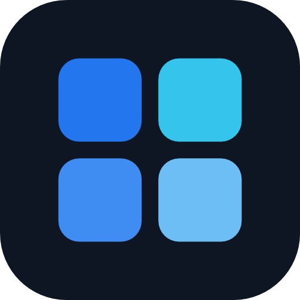

  

<h1 align="center">Flick Panel for Home Assistant</h1>

Control a tablet running [Flick Panel](https://github.com/alphasixtyfive/flick-panel)
from Home Assistant. Its display switch and actions appear on the tablet's existing
Mobile App device, alongside the sensors the tablet already reports.

Requires Home Assistant 2026.11.2 or later and Flick Panel 0.1.76 or later.

## Install

Open the repository in Marketplace and choose **Download**. In HACS, add
`alphasixtyfive/flick-panel-home-assistant` as a custom repository of type
**Integration** and download **Flick Panel**. Restart Home Assistant.

For a manual install, download the source ZIP from the
[latest release](https://github.com/alphasixtyfive/flick-panel-home-assistant/releases/latest).
Copy `custom_components/flick_panel` into Home Assistant's `custom_components`
directory and restart Home Assistant.

## Add a tablet

1. On the tablet, hold **Home** and enter your setup PIN.
2. Open **Panel → Home Assistant → Tablet link**, give the tablet a unique name, and choose **Link tablet**.
3. In Home Assistant, add **Flick Panel** under **Settings → Devices & services** and select the tablet.

If the tablet is missing from the list, check that its Mobile App device has
an enabled **Display mode** sensor. Leave that sensor enabled so the display
switch can report its state.

## Controls

| Action | What it does |
| --- | --- |
| Wake display | Return to Favourites from the blank display or idle clock |
| Blank display | Blank Flick Panel and turn brightness down |
| Start or stop screensaver | Show the idle clock and photos, or return to Favourites |
| Set display brightness | Set a temporary brightness level or clear the override |
| Show dashboard tab | Open Favourites, Rooms, or Cameras |
| Open camera | Open a camera saved on the tablet |
| Open tile | Open the full-screen view for a saved tile |
| Close viewer | Return to the dashboard |
| Launch app | Open an Android app saved as a Favourites shortcut |

The display switch and actions work while Flick Panel is in the foreground.
Android handles physical display power and its lock screen separately.
An automation can use **Wake display** with any presence sensor Home Assistant
already knows about.

Use **Set display brightness** to override the tablet’s dashboard brightness.
The screensaver keeps its own brightness limit. Open the **Display mode** sensor
to see the current brightness and any active override.

For a doorbell automation, choose **Flick Panel → Open camera** in the action
picker. Select the tablet and a camera saved in Flick Panel. Add **Close
viewer** in a separate automation if the door contact or another event should
return the tablet to its dashboard.

See the [Flick Panel user manual](https://github.com/alphasixtyfive/flick-panel/blob/main/docs/manual.md)
for tablet setup, camera talkback and backups.

The tablet's Mobile App device can report battery level, charging state, power
source, battery temperature, Battery Saver, display mode, Wi-Fi signal and
ambient light. Hardware-dependent sensors appear where supported. The tablet
sends no location updates.

[Report an issue](https://github.com/alphasixtyfive/flick-panel-home-assistant/issues)
